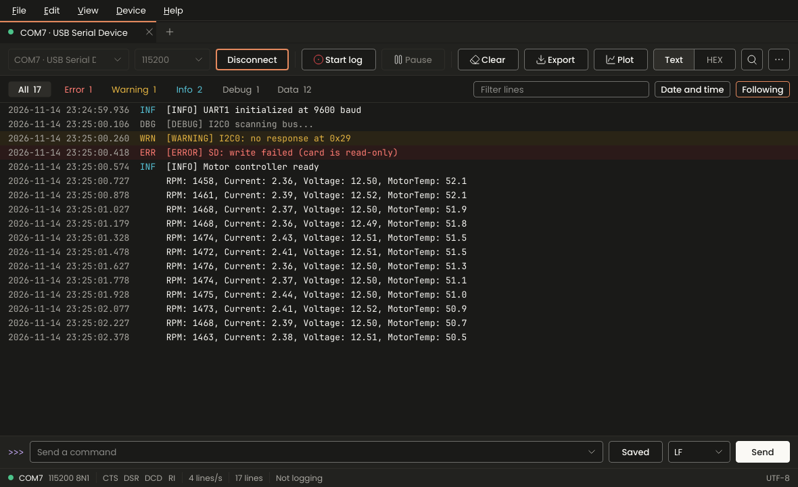
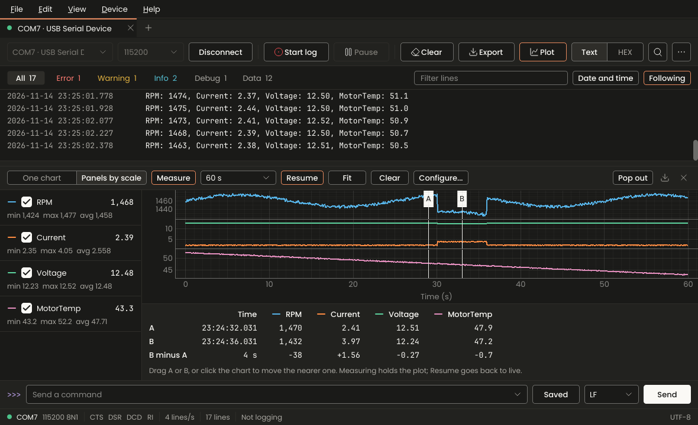
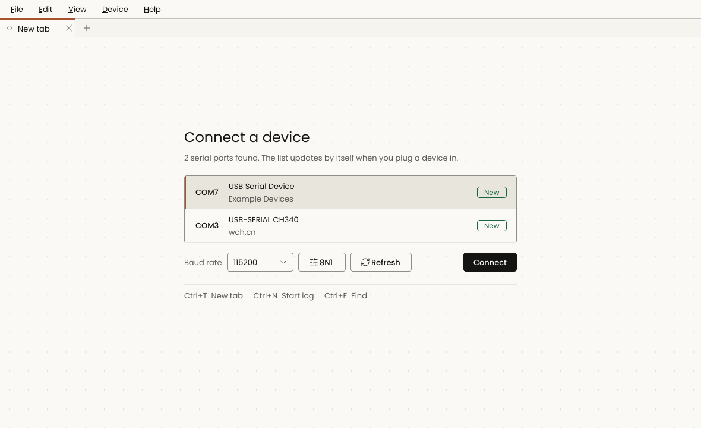
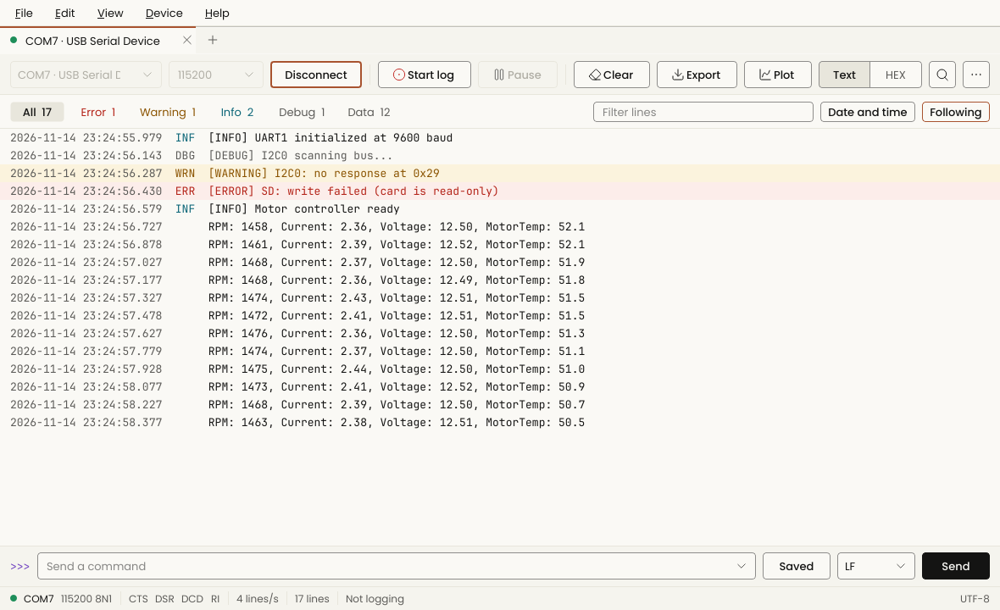
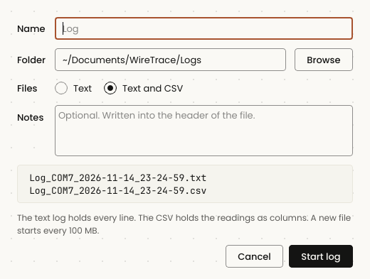
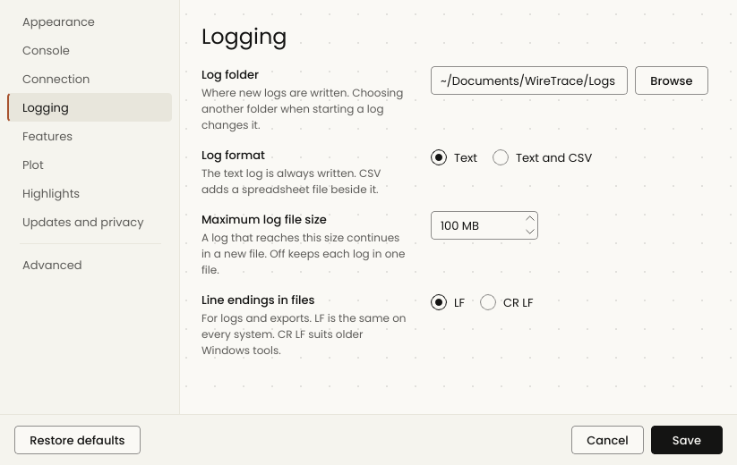
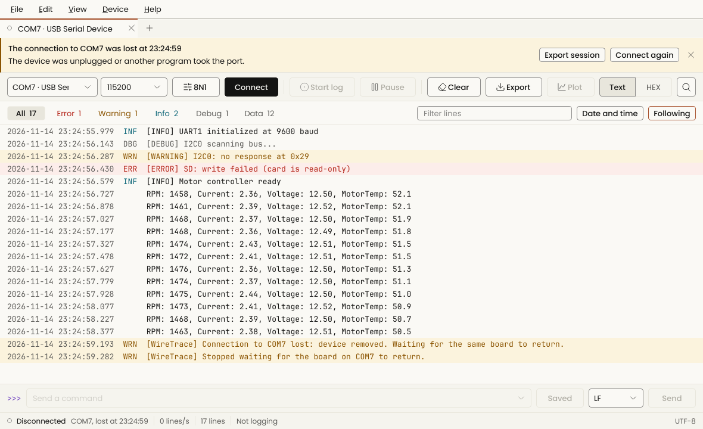
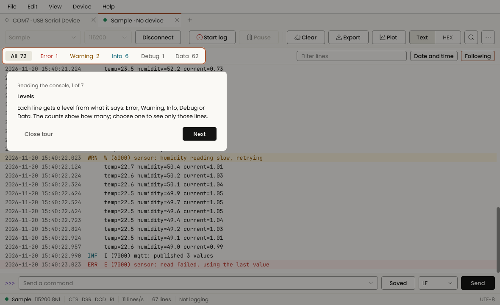

# WireTrace

A serial data monitor for hardware and embedded engineers.

WireTrace reads several serial devices at once, shows what they send as
it arrives, and writes every line to disk. It is built for hardware
bring-up and for long captures, where the line you did not keep is the
one you needed.

**[Download the latest release](https://github.com/TheNuanceProject/WireTrace/releases/latest)**

Website: [thenuanceproject.com/projects/wiretrace](https://thenuanceproject.com/projects/wiretrace)

---





<details>
<summary>More screenshots</summary>

**Before a device is connected:**



**A session, light theme:**



**Starting a log:**



**Preferences:**



**When a device is unplugged:**



**The tour, on the sample board built in:**



</details>

---

## What it does

- **Several devices, one tab each.** A tab reads, shows and logs on its
  own. Switching tabs interrupts nothing.
- **The log comes first.** Every line goes from the port to the log
  without waiting for the screen, so a busy window never slows a
  capture. How many lines a second it takes in, and the processor and
  memory it uses, are measured on GitHub's machines for every release
  and published on the
  [benchmarks page](https://thenuanceproject.com/projects/wiretrace/benchmarks/).
- **Nothing is lost quietly.** On disconnect, on an unplugged device
  and on closing, what is waiting is written before the result is
  reported. If the disk cannot keep up or fails, the number of lines
  not written is stated and marked in the file. When a device sends
  faster than the screen can show, the console says how many lines it
  skipped; they are still recorded and logged.
- **Export the session, not the screen.** Every session is recorded
  from the moment of connection, so it can be exported in full, with
  or without a log running.
- **Long captures stay easy to open.** A log that reaches the size you
  set continues in a new file.
- **Levels and colours.** Each line is given a level from its content.
  ESP-IDF, Zephyr and bracketed level markers are recognised.
- **Filter and find.** Filter the console by level or text and search
  what it holds, without changing what is written to disk.
- **Text and HEX.** Bytes can be shown and recorded as offset, hex and
  printable characters.
- **A lost board is waited for.** When a board is unplugged or resets
  its USB connection, the tab waits for the same board and continues
  the same session and log.
- **Live plot.** Numbers are found in JSON, `key: value` pairs and
  delimited values and drawn as traces, in a window of their own or
  under the console, back to the start of the session. For other
  formats, a pattern with named groups can be given and saved as a
  profile. The chart can be saved as PNG or SVG and its values as CSV.
- **Restarts and the session report.** ESP32 and Zephyr restarts are
  recognised and noted. The session report counts lines, errors,
  warnings, lost connections and restarts exactly.
- **Alerts and highlights.** A banner, a flash of the window, a sound
  and, if you choose, a desktop notification for new errors, a lost
  connection or a quiet board, paced by a time between alerts; rules that
  colour the lines you look for; ANSI colours from the device, on
  screen only.
- **Line settings.** Data bits, parity, stop bits, flow control, DTR,
  RTS and break, per port.
- **Switch off what you do not use.** Each feature can be switched off
  in Preferences, and is then not loaded at all.
- **CSV.** Lines that carry the detected columns become rows; the text
  log is always written beside the CSV.
- **Commands.** Send to the device, with history and saved commands on
  shortcuts.
- **Light and dark themes**, or the system's.
- **Verified updates.** A new version is accepted only if it is signed
  by the maintainer, and installed only when you choose. Help returns
  to the previous version the same way.
- **A diagnostic log** of WireTrace's own events stays on your
  computer, never device data and never sent. Help copies a summary to
  paste into a report.

The user guide opens from the Help menu or with F1. Help > Take the
tour... walks through every part of WireTrace on a sample board built
in.

## Platforms

| System | How |
|---|---|
| Windows 10 (version 1809) and later, 64-bit | Installer |
| Linux, x86-64, glibc 2.35 and later (Ubuntu 22.04 and later) | AppImage or `.deb` |
| macOS | From source |

WireTrace draws in software and does not need OpenGL, so it also runs
in remote desktop sessions and virtual machines.

There is no macOS download. WireTrace runs there from source, and the
interface tests run on macOS on every change.

## Install

**Code signing.** WireTrace is applying to the SignPath Foundation for
code signing. Current releases are not signed.

### Windows

Download the installer from the
[Releases page](https://github.com/TheNuanceProject/WireTrace/releases/latest)
and run it. It installs for you alone, without administrator rights,
or for all users.

### Linux

Download the `.AppImage` from the
[Releases page](https://github.com/TheNuanceProject/WireTrace/releases/latest),
make it executable (`chmod +x`) and run it. It updates itself when you
choose to update.

For Debian and Ubuntu there is also a `.deb`
(`sudo apt install ./wiretrace_*.deb`). It is updated by installing
the next one.

To open a serial port, your user must be allowed to. On many
distributions that means being in the `dialout` group.

### From source

Python 3.10 or later.

```bash
git clone https://github.com/TheNuanceProject/WireTrace.git
cd WireTrace

python -m venv .venv
.venv\Scripts\activate                 # Windows
# source .venv/bin/activate            # macOS, Linux

pip install -r requirements.txt
python main.py
```

### Uninstall

If you share usage statistics, first switch them off in Preferences,
under Updates and privacy. WireTrace then asks the server to delete
every report it sent.

- **Windows.** In Windows Settings, under Apps, choose WireTrace and
  Uninstall.
- **Linux, AppImage.** Delete the `.AppImage` file.
- **Linux, `.deb`.** `sudo apt remove wiretrace`
- **From source.** Delete the cloned folder.

Your settings, logs and WireTrace's own files are left in place. Delete
them too to remove everything:

| | Windows | Linux | macOS |
|---|---|---|---|
| Settings | `%APPDATA%\WireTrace\Config` | `~/.config/WireTrace` | `~/Library/Application Support/WireTrace` |
| Cache and session recordings | `%LOCALAPPDATA%\WireTrace\Cache` | `~/.cache/WireTrace` | `~/Library/Caches/WireTrace` |
| Diagnostic log | `%LOCALAPPDATA%\WireTrace\Logs` | `~/.local/state/WireTrace/logs` | `~/Library/Logs/WireTrace` |
| Logs | `Documents/WireTrace/Logs`, unless you chose another folder | the same | the same |

On Linux, the cache and the diagnostic log follow `XDG_CACHE_HOME` and
`XDG_STATE_HOME` when they are set.

## Privacy

The privacy policy is [PRIVACY.md](./PRIVACY.md), also at
[thenuanceproject.com/privacy](https://thenuanceproject.com/privacy/).

## Verifying a download

Every release carries a `SHA256SUMS` file, a bill of materials and the
licence texts of everything it contains. See
[SECURITY.md](./SECURITY.md).

## Building

See [BUILD_GUIDE.md](./BUILD_GUIDE.md) for how releases are built and
how to make a build on your own computer.

## Contributing

Contributions are welcome; please read
[CONTRIBUTING.md](./CONTRIBUTING.md) first, and the
[Code of Conduct](./CODE_OF_CONDUCT.md).

Security issues: see [SECURITY.md](./SECURITY.md).

## Supporting WireTrace

WireTrace is free and stays free. If it is useful to you and you would
like to support its development, you can do so through
[GitHub Sponsors](https://github.com/sponsors/shahin-hashim), at any
amount you choose.

## Licence

WireTrace is free and open-source software under the
[GNU General Public License, version 3 or later](./LICENSE). You are
welcome to use it, study it, change it and share it. If you share it,
or a version you have changed, it stays open source under the same
licence.

The licences of the third-party work WireTrace contains are listed in
[NOTICE](./NOTICE).

Versions 1.0.0 to 1.2.0 were released under the MIT License and remain
available under it.

WireTrace is an independent project by The Nuance Project and is not
affiliated with any other product or company that uses a similar name.

---

Built under [The Nuance Project](https://thenuanceproject.com) by
Mohamad Shahin Ambalatha Kandy.
