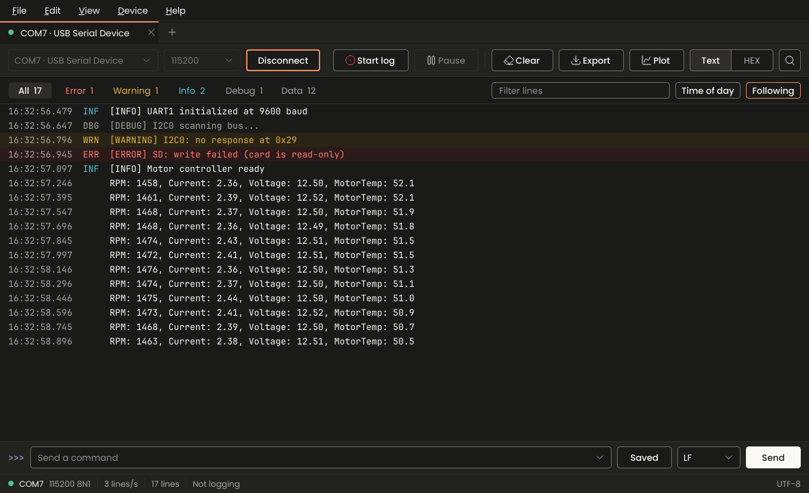
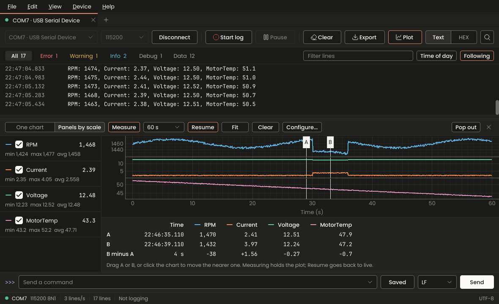
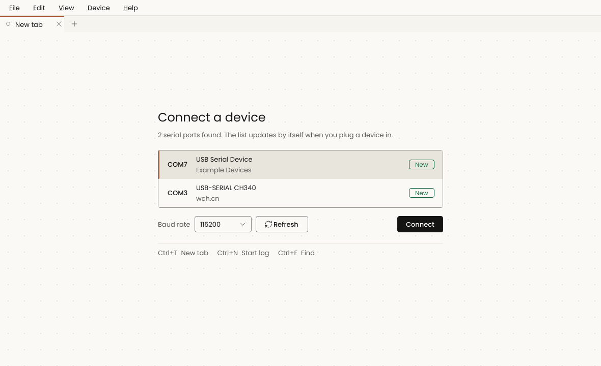
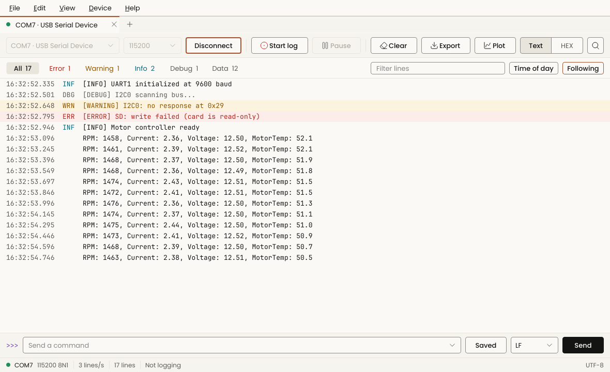
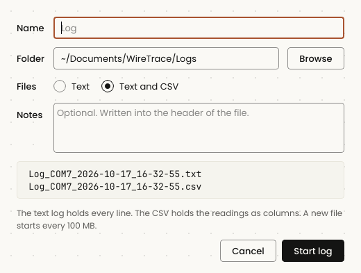
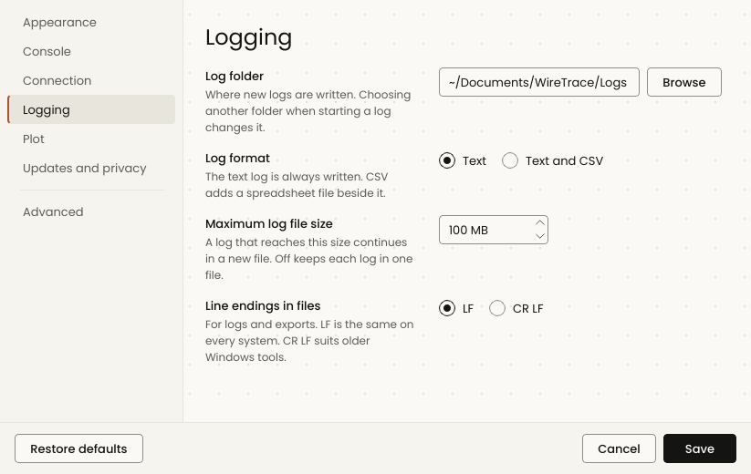
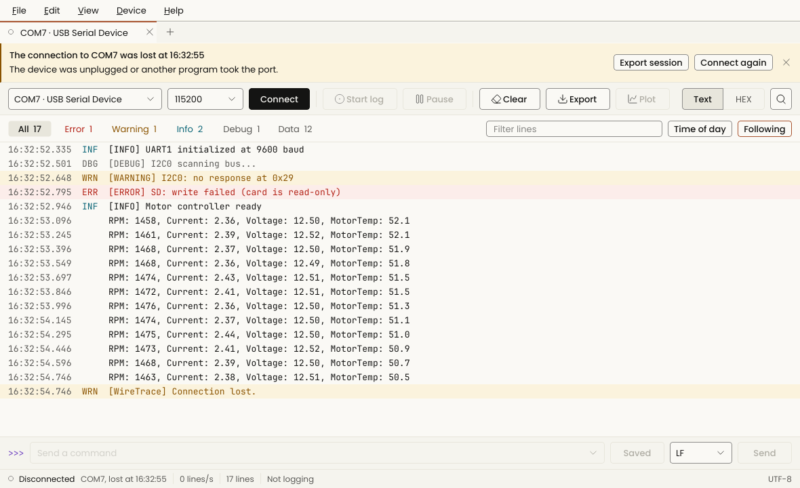

# WireTrace

A serial data monitor for hardware and embedded engineers.

WireTrace reads several serial devices at once, shows what they send as
it arrives, and writes every line to disk. It is built for hardware
bring-up and for long captures, where the line you did not keep is the
one you needed.

**[Download the latest release](https://github.com/TheNuanceProject/WireTrace/releases/latest)**

Website: [thenuanceproject.com/projects/wiretrace](https://thenuanceproject.com/projects/wiretrace)

---





<details>
<summary>More screenshots</summary>

**Before a device is connected:**



**A session, light theme:**



**Starting a log:**



**Preferences:**



**When a device is unplugged:**



</details>

---

## What it does

- **Several devices, one tab each.** A tab reads, shows and logs on its
  own. Switching tabs interrupts nothing.
- **Reading, writing and drawing are separate.** The port is read on
  one thread and the log is written on another, so a busy window or a
  slow disk does not delay reading. A test sends a burst through a
  stand-in for the port, using the real reader and writer, and holds
  the path to the log file to ten thousand lines a second, complete and
  in order, on every run of the checks
  (`tests_gui/test_throughput.py`).
- **Nothing is lost quietly.** On disconnect, on an unplugged device
  and on closing, what is waiting is written before the result is
  reported. If the disk cannot keep up or fails, the number of lines
  not written is stated and marked in the file. When a device sends
  faster than the screen can show, the console says how many lines it
  skipped; they are still recorded and logged.
- **Export the session, not the screen.** Every session is recorded
  from the moment of connection, so it can be exported in full, with
  or without a log running.
- **Long captures stay easy to open.** A log that reaches the size you
  set continues in a new file.
- **Levels and colours.** Each line is given a level from its content.
  ESP-IDF, Zephyr and bracketed level markers are recognised.
- **Filter and find.** Filter the console by level or text and search
  what it holds, without changing what is written to disk.
- **Text and HEX.** Bytes can be shown and recorded as offset, hex and
  printable characters.
- **Live plot.** Numbers are found in JSON, `key: value` pairs and
  delimited values and drawn as traces under the console. For other
  formats, a pattern with named groups can be given and saved as a
  profile.
- **CSV.** Lines that carry the detected columns become rows; the text
  log is always written beside the CSV.
- **Commands.** Send to the device, with history and saved commands on
  shortcuts.
- **Light and dark themes**, or the system's.
- **Verified updates.** A new version is accepted only if it is signed
  by the maintainer, and installed only when you choose.

The user guide opens from the Help menu or with F1.

## Platforms

| System | How |
|---|---|
| Windows 10 (version 1809) and later, 64-bit | Installer |
| Linux, x86-64, glibc 2.35 and later (Ubuntu 22.04 and later) | AppImage or `.deb` |
| macOS | From source |

WireTrace draws in software and does not need OpenGL, so it also runs
in remote desktop sessions and virtual machines.

There is no macOS download. WireTrace runs there from source, and the
interface tests run on macOS on every change.

## Install

**Code signing.** WireTrace is applying to the SignPath Foundation for
code signing. Current releases are not signed.

### Windows

Download the installer from the
[Releases page](https://github.com/TheNuanceProject/WireTrace/releases/latest)
and run it. It installs for you alone, without administrator rights,
or for all users.

### Linux

Download the `.AppImage` from the
[Releases page](https://github.com/TheNuanceProject/WireTrace/releases/latest),
make it executable (`chmod +x`) and run it. It updates itself when you
choose to update.

For Debian and Ubuntu there is also a `.deb`
(`sudo apt install ./wiretrace_*.deb`). It is updated by installing
the next one.

To open a serial port, your user must be allowed to. On many
distributions that means being in the `dialout` group.

### From source

Python 3.10 or later.

```bash
git clone https://github.com/TheNuanceProject/WireTrace.git
cd WireTrace

python -m venv .venv
.venv\Scripts\activate                 # Windows
# source .venv/bin/activate            # macOS, Linux

pip install -r requirements.txt
python main.py
```

### Uninstall

If you share usage statistics, first switch them off in Preferences,
under Updates and privacy. WireTrace then asks the server to delete
every report it sent.

- **Windows.** In Windows Settings, under Apps, choose WireTrace and
  Uninstall.
- **Linux, AppImage.** Delete the `.AppImage` file.
- **Linux, `.deb`.** `sudo apt remove wiretrace`
- **From source.** Delete the cloned folder.

Your settings and logs are left in place. Settings are in
`%APPDATA%\WireTrace\Config` on Windows, `~/.config/WireTrace` on Linux
and `~/Library/Application Support/WireTrace` on macOS; logs are in
`Documents/WireTrace/Logs` unless you chose another folder. Delete them
too to remove everything.

## Privacy

What your devices send stays on your computer, in the files you choose
to write.

WireTrace checks for a new version when it starts and every 12 hours while
it stays open. The request states the WireTrace version, the operating
system, the processor type, how WireTrace was installed and the date of
the previous check. It carries no identifier and nothing about you,
your devices or your data. Like any request, it reaches the server from
a network address: the server derives the country and an approximate
area (about 100 km) from it, uses the address for no more than a minute
to limit abuse, and never stores it. The file it reads is on the
website, which GitHub Pages hosts, so GitHub also receives the request,
as it does every visit to the website. The check can be turned off in
the Windows installer and at any time in Preferences, under Updates and
privacy.

Usage statistics are off unless you switch them on. WireTrace asks
once, with a bar that blocks nothing, and the setting stays in
Preferences. If you share them, WireTrace makes a random installation
identifier and sends one report for each day it is used: the
identifier and the date; its version, the operating system, the
processor type and how it was installed; which features were used;
whether lines were lost, a log could not be written, a connection was
lost or WireTrace closed unexpectedly; the highest line rate, the
number of connections, the longest time one window stayed open and the
number of starts, each as a range; the theme; and the display scale. A
report never holds a port or device name, a file name, a command, or
anything a device sent. The server keeps reports for 14 months under a
one-way hash of the identifier. Switching statistics off deletes the
identifier and everything kept on your computer, and asks the server to
delete every report sent under it.

These are the only connections WireTrace makes by itself. The privacy
policy, with every value a report can hold, is at
[thenuanceproject.com/privacy](https://thenuanceproject.com/privacy/).

## Verifying a download

Every release carries a `SHA256SUMS` file, a bill of materials and the
licence texts of everything it contains. See
[SECURITY.md](./SECURITY.md).

## Building

See [BUILD_GUIDE.md](./BUILD_GUIDE.md) for how releases are built and
how to make a build on your own computer.

## Contributing

WireTrace is maintained by one person in spare hours. Contributions
are welcome; please read [CONTRIBUTING.md](./CONTRIBUTING.md) first,
and the [Code of Conduct](./CODE_OF_CONDUCT.md).

Security issues: see [SECURITY.md](./SECURITY.md).

## Supporting WireTrace

WireTrace is free and stays free. If it is useful to you and you would
like to support its development, you can do so through
[GitHub Sponsors](https://github.com/sponsors/shahin-hashim), at any
amount you choose.

## Licence

WireTrace is free and open-source software under the
[GNU General Public License, version 3 or later](./LICENSE). You are
welcome to use it, study it, change it and share it. If you share it,
or a version you have changed, it stays open source under the same
licence.

The licences of the third-party work WireTrace contains are listed in
[NOTICE](./NOTICE).

Versions 1.0.0 to 1.2.0 were released under the MIT License and remain
available under it.

WireTrace is an independent project by The Nuance Project and is not
affiliated with any other product or company that uses a similar name.

---

Built under [The Nuance Project](https://thenuanceproject.com) by
Mohamad Shahin Ambalatha Kandy.
